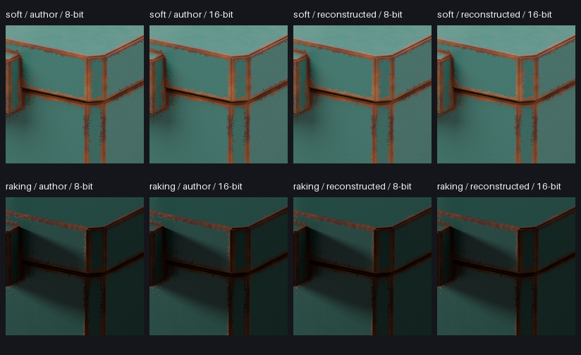
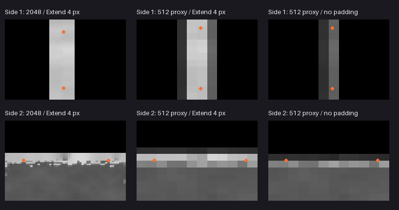

# 原生箱角近景：遮罩阈值、接缝与扩边

## 输入与固定变量

沿用 [R15](helper-mask-depth-native.md) 的便携工具箱、喷漆金属配方、原 UV 和种子。这次相机锁定正面右侧箱角，512²、两种灯光、同一正交机位、32 渲染样本、16 最终通道烘焙样本。Edge/Cavity 各用 8 样本、8 像素辅助扩边。把 512² 和 2048² 辅助图分别做原生 8 位／浮点缓冲 PNG16 的配对，下游统一烘成 2048²、16 位、Extend 4 像素。记录实际输入 SHA、同批相机、源 UV 和 Alpha 一致性。生产插件不改。

工具：Linux Blender 5.3.0（`02f0899d78e3`）、CLI `4046c7a8677514e45b2490a12133b9e587ec279f`、材质 PR #3 `0f39fcf0c62ee71f8264e807b52d18722ed20388`，沿用 R15 隔离适配。数值探针只在临时烘焙材质复制节点组，输出无扩边的 32 位浮点 EXR：R 是实际连入 `coating_loss` 的 susceptibility，G 是节点输出，B 是最终粗糙度，A 是原始覆盖。原版配方使用 0.25–0.28 的平滑重映射，不是 R15 的 0.5 硬切。

## 执行

1. 在 R15 复跑根准备通过 SHA 和原复跑说明验证的 `cli/` 和 `cli16/`，两者各应用一次 [探针补丁](evidence/corner-seam/probe.patch)。这只增加报告中的实验辅助文件，不增加重建材质的通道或依赖。
2. [复跑脚本](evidence/corner-seam/replay.sh) 从 R15 清单生成匹配近景并调度四组；[数值脚本](evidence/corner-seam/probe_corner.py) 用 FFmpeg 解码线性浮点 EXR，用 ImageMagick 读取最终 PNG 16 位，NumPy/SciPy 取样。检查探针 B 与正式粗糙度的盘上读数吻合；核对节点实际连线、原清单阈值及共同覆盖。重映射和烘焙取样不能假定可互换，因此分别读 R 与 G，不在盘上用 R 倒推 G。
3. 几何先选箱角范围与前板内部对照，按实际 UV 三角形把纹素中心反查到表面；覆盖只采原始 alpha 满足条件的样本。实际切口沿同一网格边的 20%–80% 等距取 65 对，在两相邻面各偏入 0.3 mm。比较同一位置在不同缩图级别的变化，而不是假定两个面在原图就应相同。
4. 以线性 Roughness 做盒式缩图 2K → 1K → 512 → 256 → 128，在同样坐标双线性采样。用真正的零扩边探针 B 作负对照；正组读取最终 Extend 贴图。只测离线缩图代理，不声称跑过 GPU 的纹理压缩、各向异性或具体 mip 选择。
5. 迁移重建版时，新目录保持原相对结构，只复制重建工程及其声明贴图。用 [冷开脚本](evidence/corner-seam/cold_verify.py) 调独立 CLI `project verify`，验证所有实际依赖都在新根内且校验值匹配。隔离副本使用 [只读 Linux 守护补丁](evidence/corner-seam/cold-linux.patch)，不改生产。结构冷开与同机位实渲是两种证据。

```sh
git -C cli apply --check "$EVIDENCE/probe.patch"
git -C cli apply "$EVIDENCE/probe.patch"
git -C cli16 apply --check "$EVIDENCE/probe.patch"
git -C cli16 apply "$EVIDENCE/probe.patch"
BLENDER_BIN="$VERIFIED_BLENDER" CPUSET="$ALLOWED_CPUSET" \
  EVIDENCE="$EVIDENCE" bash "$EVIDENCE/replay.sh"
cp -a cli coldctl
git -C coldctl apply --check --ignore-space-change "$EVIDENCE/cold-linux.patch"
git -C coldctl apply --ignore-space-change "$EVIDENCE/cold-linux.patch"
python "$EVIDENCE/cold_verify.py" r16 relocated coldctl/tools/blenderctl/cli.py \
  "$VERIFIED_BLENDER" 2048-b8 2048-f16
```

图像验证与缩图是不同实验。Adobe 的 [扩边文档](https://experienceleague.adobe.com/en/docs/substance-3d-painter/using/technical-support/workflow-issues/export-issues/texture-dilation-or-padding) 解释为什么低级纹理容易混入背景；[Blender Cycles 烘焙手册](https://docs.blender.org/manual/en/5.3/render/cycles/baking.html) 定义原生扩边方式。本例不比较 Blender 的 Adjacent Faces 模式。

## 箱角与真实阈值

便携箱右前盖角与前板中央用物理坐标圈定，UV 覆盖相同。对 2K 辅助图配对，19,064 个箱角纹素中，重映射前落在过渡带的分别为 69／71，并集 71；后置遮罩在并集内平均绝对差 0.00138。整个箱角最大的遮罩差 0.0151，但最终粗糙度的最大差只有 0.00623，达到 0.01 的为 0；前板 16,492 个纹素完全一致。512² 辅助图配对在同一 2K 输出中，过渡带 58／58、并集 58，箱角粗糙度最大差 0.00940、达到 0.01 的同样为 0；前板也完全一致。

在相同 2K 原生 8 位组，若直接对烘后的输入贴图套平滑公式，和实际节点先重映射再烘出的遮罩相比，箱角有 1,027／19,064 处差至少 0.01，最大约 0.625，前板对照为零。该对照证明不能用单张已烘焙输入图反推烘焙遮罩；这轮没有单独隔离烘焙采样、边缘覆盖与插值各自的贡献。



上图为 2K 辅助图配对的原生近景缩略。分别看原始 512² 预览中的纯贴图重建版与作者版的柔光、掠射成对帧。不同位深的 2K 纯图版单个 RGB 通道最大差为 10／18 个 8 位显示码值，至少差四码的像素为 57／31（每帧 262,144），没有可稳定辨认的位深改善；不以平均值抹去少量像素变化。该对照不授予资产最终观感放行。

## UV 切口及缩图代理

实际切口为顶点 93→136，面 299 / 564，位置约 `x=.2354, y=-.118, z=.1436→.1854 m`，两面使用不同 UV。2K 初始分辨率全部 65 对均有原始探针覆盖；两侧前置输入都未落进过渡带。这条切口与箱角 ROI 我们分别统计，不能凭切口结果代表所有磨损区。

| 粗糙度缩图 | 原生 4 px Extend 与 2K 读数平均绝对差 | 同一面的零扩边负对照 | 4 px Extend 下的 8/16 位平均差 |
| --- | ---: | ---: | ---: |
| 1K（L1） | 0.0231 | 0.1797 | 0.000057 |
| 512（L2） | 0.0430 | 0.3874 | 0.000051 |
| 256（L3） | 0.1796 | 0.4901 | 0.000027 |

误差按原生 8 位辅助图路线取 130 个实际面内点，表中小数取舍不代替回执。4 px Extend 有明显作用，但这条缝的 512 缩图代理仍变化 0.0430，远大于升位深的影响。成因包含正常低通与边缘背景混入，不把所有差值叫渗色。额外用原生零边距的覆盖和数值做最近像素填充对照：L3 上 4／8／16 px 分别约 0.180／0.078／0.067；L2 三档均约 0.043。它提示填充继续加宽不一定改变目标级别，且不是 Blender 原生 8／16 px 或目标引擎实测。



先核查目标输出尺度、岛边扩边及岛距，再考虑位深。保留 8 位辅助图默认；保留对同资产逐图升级的空间。

## 迁移与回执

两件 2K 辅助图重建工程分别复制到全新位置，各在独立后台进程打开。两个重建文件和各自的九张贴图 SHA 未变，九条实际依赖均在新根内、无未声明路径。这里只验证迁移后打开和依赖；迁移前已完成四组作者与重建近景，迁移后未另渲。

[四组数值、取样坐标与原图 SHA](evidence/corner-seam/receipt.json) · [8 位工程冷开](evidence/corner-seam/reopen-2048-b8.json) · [16 位工程冷开](evidence/corner-seam/reopen-2048-f16.json) · [近景图集脚本](evidence/corner-seam/make_plate.py) · [UV 图集脚本](evidence/corner-seam/seam_plate.py)。
