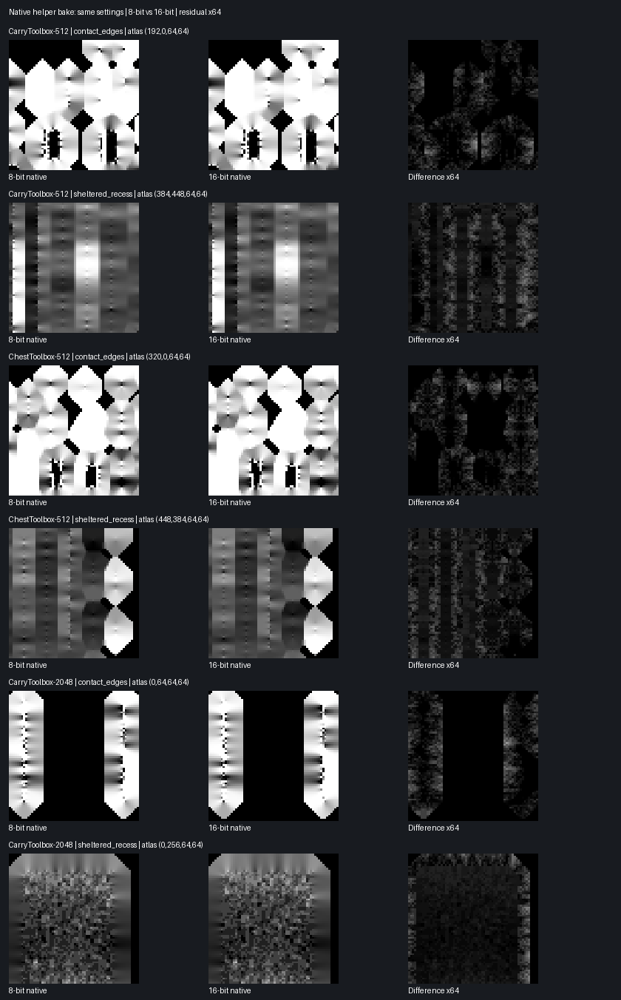

# 原生辅助遮罩 A/B：8 位与 16 位

## 可复跑输入

沿用 [R14](mesh-map-resolution-native.md) 的两件原创喷漆工具箱、固定配方及 UV。复跑环境：Linux Blender 5.3.0 构建 `02f0899d78e3`、CLI `4046c7a8677514e45b2490a12133b9e587ec279f`、插件 `0f39fcf0c62ee71f8264e807b52d18722ed20388`，以及 R14 的 CLI 兼容补丁。保持两套独立 CLI，不改生产插件。8 位走原有字节缓冲；16 位重烘采用浮点缓冲、Raw 输出、RGB PNG16、零抖动，并检查实际 IHDR 和 Non-Color 往返误差。[实验补丁](evidence/helper-depth/mesh16.patch)只用在隔离副本。

两箱各跑 512² 辅助图；便携箱追加 2048² 辅助图及完整的同规格 2048²、16 位 PBR 导出。Edge/Cavity 各 8 样本，扩边 8 像素。源文件、输入合同和辅助图网格指纹逐对相同。比对脚本用 ImageMagick 原始 16 位解码，不经过 Pillow RGB8 转换；Pillow 仅用于拼图。独立复验指第二件不同形体和 R14 8 位文件字节复跑，不表示第三人审核。

```sh
# 解开 R14 复跑包，并按它的说明在独立目录准备已核验的 cli/。
# 从该复跑根目录执行；补丁和脚本取自本页的证据目录。
cp -a cli cli16
git -C cli16 apply --check "$EVIDENCE/mesh16.patch"
git -C cli16 apply "$EVIDENCE/mesh16.patch"
BLENDER_BIN="$VERIFIED_BLENDER" CPUSET="$ALLOWED_CPUSET" \
  bash "$EVIDENCE/replay-helper-depth.sh" 512 CarryToolbox ChestToolbox
BLENDER_BIN="$VERIFIED_BLENDER" CPUSET="$ALLOWED_CPUSET" \
  bash "$EVIDENCE/replay-helper-depth.sh" 2048 CarryToolbox
python "$WIKI/labs/probe_helper_depth.py" "$PWD/r15" "$OUTPUT" \
  CarryToolbox-512 ChestToolbox-512 CarryToolbox-2048
```

## 双箱结果

| 模型 | 辅助图 | 实际码值数（8 → 16） | 非零像素平均绝对差 | 原始 0.5 硬切翻转 |
| --- | --- | ---: | ---: | ---: |
| Carry | Edge | 256 → 30,500 | 0.00062 | 42 |
| Carry | Cavity | 256 → 27,828 | 0.00124 | 161 |
| Chest | Edge | 256 → 28,561 | 0.00067 | 55 |
| Chest | Cavity | 256 → 24,643 | 0.00120 | 203 |

16 位重载与浮点缓冲误差约 0.0000077。512² 两图合计体积各约增至 1.9 倍。四份 8 位图与 R14 文件逐字节一致。取两档非零并集，四组均没有绝对差达到 0.01 的辅助图像素。0.5 硬切是额外诊断，不是原配方阈值；**不能**把 16 位结果四舍五入回 8 位当作原生 8 位对照，实测两者仍有 12%–22% 的非零并集像素落在不同的 8 位码上。这里比较的是两条原生缓冲到保存的完整路线，并未隔离误差究竟来自哪一环的舍入。

每组看同相机的 320² 工作预览，柔光和掠射光成对比较，整帧平均误差低于 0.003/255；仍有少数局部像素变化。没有近景画质收益证据，不建议整体升级默认值。低分辨率或低采样问题先单独测，不用提升位深替代。



[同机位柔光和掠射光预览（缩图）](images/helper-depth-views.png)。

## 2K 下游验证：便携箱

两档辅助图都是 2048²；两组最终贴图也都是 2048²、16 位，Alpha 文件像素完全一致。在距离共同 Alpha 覆盖外缘超过 12 纹素的内部区域，粗糙度绝对差达到 0.01 的只有 **104／1,389,603** 个纹素（约 0.0075%），最大约 0.02124；金属度达到同阈值的有 54 个纹素。两图文件大小合计由 1.86 MB 升到 3.46 MB，完整作业约 177.0 → 180.4 秒；单次对照，不是通用性能预算。作者与纯贴图版均保存并在各自作业内重开；320² 两种照明没有给出稳定的画质提升依据。这次没有运行独立迁移冷开、最终特写、游戏引擎或正式视觉审核。

[数值与 SHA 回执](evidence/helper-depth/helper-depth-receipt.json) · [像素对照命令](probe_helper_depth.py) · [复跑脚本](evidence/helper-depth/replay-helper-depth.sh)。
