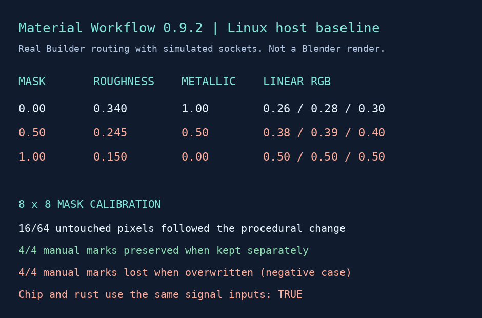

# 遮罩与通道：0.9.2 基线

**范围：Linux 主机，调用真实 Builder，节点用数学替身。此页复现旧行为，不是新版修复验收。**

从仓库根目录执行：

```sh
python docs/wiki/labs/probe_mask.py
```

| 判定项 | 实际结果 |
| --- | --- |
| 权重 0／0.5／1，粗糙度 | 0.34／0.245／0.15，符合预期 |
| 同三点，金属度 | 1／0.5／0，串改；正确值必须全为 1 |
| 全权重底色 | (0.50, 0.50, 0.50)，串改；正确值为 (0.26, 0.28, 0.30) |
| 掉漆与锈蚀 | 同输入、同阈值、同插值；内置配方失败 |
| 8×8 正例：分开保存加／减 | 16 个无笔迹点随程序变化，4 个笔迹点全部保留 |
| 8×8 反例：用新程序直接覆盖 | 4 个笔迹全部丢失 |



Blender 复验：冻结 UV 和三处采样，保存并冷开，改程序阈值后重建，再导出贴图并在干净 Blender 工程回读。记录正反截图和图层输入。此步骤未完成；暂不晋升配方。
