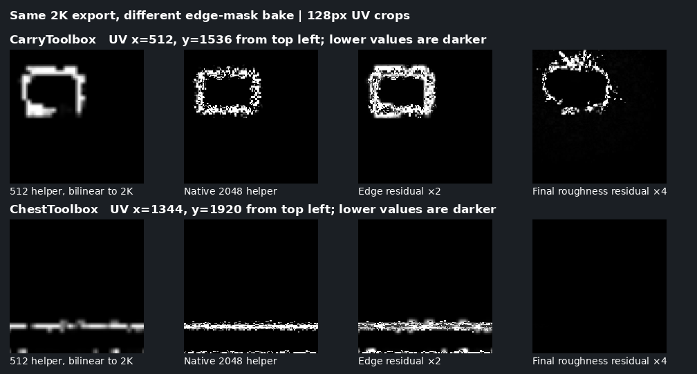
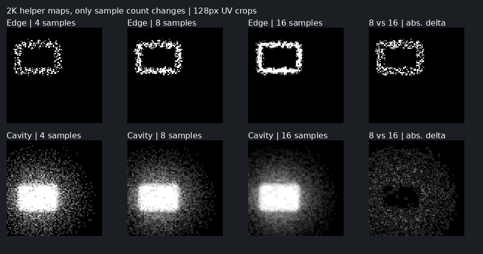
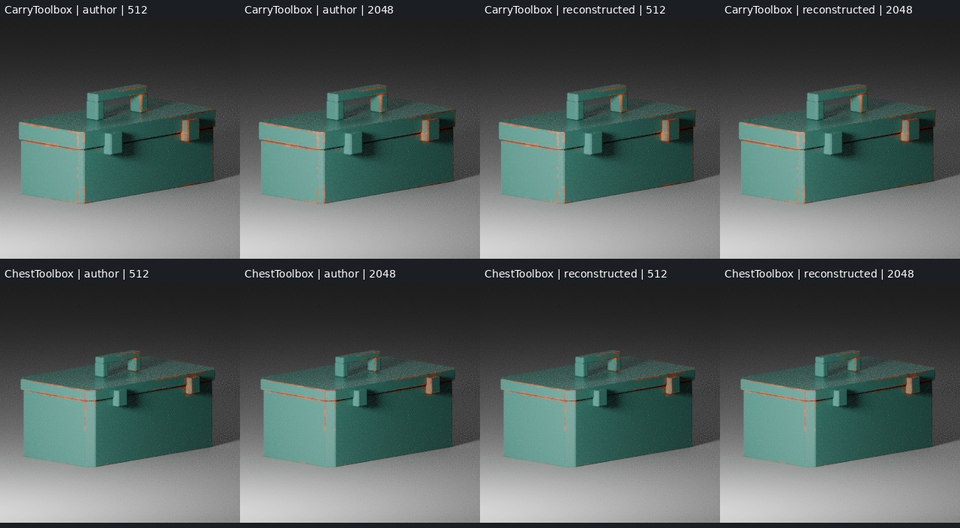

# 双工具箱：固定 2K 导出，对照 512 / 2048 辅助图

## 2K A/B 对照

同一白模和相同最终烘焙设置，只切换配方内 `mesh_map_size`。辅助图用 Blender Cycles CPU 计算。Edge = 倒角着色法线与当前法线的点积偏差乘增益；Cavity = 靠本物体遮挡的反相值。这两份图不是符号曲率，也不是 Selected to Active 的投射结果。

使用 R12 双箱喷漆配方、R13 白模、Blender 5.3.0（02f0899d78e3）、[材质 PR #3 固定提交](https://github.com/tsist/blender-material-workflow/commit/0f39fcf0c62ee71f8264e807b52d18722ed20388)，以及 [CLI 0.64.0 基线](https://github.com/tsist/blenderctl/commit/4046c7a8677514e45b2490a12133b9e587ec279f) 加 R13 隔离补丁。实验显式设 512 / 2048；不是在测内置喷漆预设的 256 默认档。最终贴图 2048²、边距 4 px、16-bit、16 samples；辅助图 `Non-Color`、8 px 扩边、每信号 8 samples。节点版/纯贴图版分别用 320²、16 samples、同视角的软光/掠射光对比。

```sh
blenderctl --jobs-dir "$jobs" material procedural-run "$whitebox" \
  --expected-sha256 "$source_sha" --resources "$empty_resources_json" \
  --manifest "$variant_json" --export "$final_2048_settings"
```

量测使用两档均有覆盖的区域。分别检查含扩边的覆盖范围和离该外轮廓超过 36 个 2K 纹素的内区；内区门槛是本实验的测量区，不是产品 UV 留边规范。辅助图用纹素中心对齐的双线性放大作低档对照。最终 Base Color 用编码码值、标量贴图用线性码值，法线比较原始编码分量，不把 PNG 差值当感知色差、物理粗糙度误差或法线角度。

## 两箱结果

| 样件 | 共享内区纹素 | Edge 差 ≥ 0.01 | Cavity 差 ≥ 0.01 | 最终 Roughness 差 ≥ 0.01 |
| --- | ---: | ---: | ---: | ---: |
| 便携箱 | 987,935 | 1.84% | 11.58% | 0.83% |
| 深箱 | 1,052,294 | 1.02% | 8.18% | 0.55% |

- 两档辅助 PNG 都是 8-bit；最终输出两档都为 2048²、16-bit。工具箱轮廓与 Alpha 覆盖相同。不同辅助栅格仍改变了最终底色、粗糙度、金属度、法线的局部；上表是差异范围，不是画质提升百分比。
- 2K 原生辅助图保留更多局部变化，8 samples 下也显出块状和细碎起伏。深箱的最强 Edge 差异裁片内，最终粗糙度最大差只有 64/65535；在便携箱的同类裁片，这一差值达到 31007/65535。先看最终通道，不以辅助图视觉差替代成品判定。把挖补、破漆不规则交给显式程序纹理和手工输入，不依赖烘焙噪声制造细节。
- 这里同时改变 Edge 与 Cavity 的栅格，不把最终差异只归给 Edge。固定的 8 px 辅助边距使两档的归一化留边不同；接缝和 mip 另验。两档仍是试样，不给 AAA 画质结论。



## 固定 2K：采样不是分辨率

在便携箱上仅把两种信号的采样数分别设为 4、8、16。单独运行的 8 样本档与前面全流程两张辅助 PNG 的 SHA 完全相同。以 16 样本作为对照而非真值，在任一档大于 0.05 的 UV 内区比较：

| 信号 | 样点 | 4 相对 16 平均绝对差 | 8 相对 16 平均绝对差 |
| --- | ---: | ---: | ---: |
| Edge | 13,573 | 0.3622 | 0.2428 |
| Cavity | 416,799 | 0.0244 | 0.0141 |

16 档在该局部的凸缘更连贯、凹处梯度更平滑；8 与 16 仍存在明显差异。精度测试未改变图像位深，未复跑 16 档的最终贴图与场景。不要把样本噪点固化为智能材质的设计细节。



可用上限：当前[配方合同](https://github.com/tsist/blender-material-workflow/blob/0f39fcf0c62ee71f8264e807b52d18722ed20388/procedural_contract.py#L175-L190) 将 Edge/Cavity 的 `samples` 限为 1–16。两种信号分别单独提交 32，均报 `INVALID_REQUEST`，未启 Blender；内部烘焙函数的较大上限不是已开放入口。

官方对照：[Blender Bevel](https://docs.blender.org/manual/en/latest/render/shader_nodes/input/bevel.html)、[Blender Ambient Occlusion](https://docs.blender.org/manual/en/5.3/render/shader_nodes/input/ao.html)、[Painter 辅助图设置](https://experienceleague.adobe.com/en/docs/substance-3d-painter/using/baking/mesh-map-settings)。

## 对结果负责的选档

- 四份导出都做了目标保护、保存后重开、从盘面贴图重建与同机位试渲。320² 整体图没有稳定的观感提升，各帧显示 RGB 的平均差为 0.22–0.43 / 255；差异集中在局部，正式特写仍需实看。
- 顺序运行四个任务，完整作业耗时分别为便携箱 170.0 → 182.3 秒、深箱 173.1 → 178.5 秒；同进程在重建预览时记录的峰值 RSS 约 1.23–1.24 → 1.30 GiB。每件两张辅助 PNG 合计 0.24–0.27 → 1.50–1.77 MiB。报告的是这批 CPU 观测，不以它预测其他资产。
- 512 用于迭代；需要靠近镜头看开裂、磕碰或接缝时，以同机位取景、通道局部和边缘 mip 做选档。需要更平滑的分层信号时，单独测试位深和采样。


