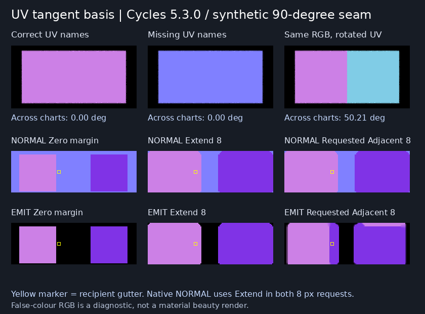

# 切线法线：原生扩边、普通 RGB 扩边和缺失 UV 的对照

**原生 NORMAL + TANGENT 请求 Adjacent Faces 仍走 Extend。** [固定构建的 Bake 初始化](https://github.com/blender/blender/blob/02f0899d78e3/source/blender/editors/object/object_bake_api.cc#L1775-L1779) 覆盖模式，也对 UV pass 如此。实验实测的是原生切线 Normal，UV pass 仅核源码。**普通 EMIT 的 Adjacent Faces 是另一条路**，不能直接拿来给现成的切线法线 RGB 做跨岛扩边。

## 实验

- Blender 5.3.0 `02f0899d78e3`、Cycles CPU SVM、8 样本、种子 0，正面正交，测量线性浮点 EXR。渲染只用于读取实际法线方向，不是产品渲染。
- 合成平片两面共享一条几何边；左岛 `T=+X, B=+Y`，右岛 `T=+Y, B=−X`。高模是斜率 `−0.75` 的连续平面，世界法线恒定 `(0.6, 0, 0.8)`。烘焙 128²，原生切线 OpenGL +Y。
- 另在平片材质中逐次测量 Normal Map 的世界方向，常量颜色跟随试验控制；缺失名称一组仅改 Normal Map 的 UV 名，不动颜色。[固定构建如何解析命名切线](https://github.com/blender/blender/blob/02f0899d78e3/intern/cycles/scene/shader_nodes.cpp#L7378-L7418)；[缺失时的 SVM 回退](https://github.com/blender/blender/blob/02f0899d78e3/intern/cycles/kernel/svm/tex_coord.h#L233-L248)。

| 对照 | 实测 |
| --- | --- |
| 正确命名 UV，按各岛分别编码 | 左右均倾斜 36.870°，朝 +X，两侧方向一致 |
| 强度 0；强度 1 但 UV 名不存在 | 两种均返回 +Z；单看平整表面无法区分 |
| 两岛读同一 RGB、不换基编码 | 左偏 +X，右偏 +Y，两岛方向差 50.208° |
| 原生 Normal 零扩边 → Extend 8 | 改变 2,336 个岛外像素；零扩边空白填的是中性法线而不是透明，不能用该图 Alpha 判岛 |
| 原生 Normal Extend 8 → 请求 Adjacent Faces 8 | 0 像素变化，浮点数组与 EXR SHA 都一致 |
| EMIT Extend 8 → Adjacent Faces 8 | 1,493 个 RGBA 像素变化；共享边左岛 gutter 的 262 个像素由本岛颜色换成右岛颜色 |

岛外取点 `(50,48)`，以左下为原点。EMIT Extend 给出约 `(0.8,0.5,0.9)`；EMIT Adjacent Faces 给出约 `(0.5,0.2,0.9)`。把后者当左岛的一整份法线来解，方向错 **50.208°**。这是该 gutter 像素经基变换计算的误差，不代表相机实际通过滤波读到同样大的误差。



## 复跑

在新目录解包已登记的 R16 / R17 单件复跑包为 `r16/`、`r17/`；使用团队云端登记的上述 Blender 构建。下面脚本仅在新目录组装固定 CLI 和材质草稿，先通过 CLI 做已校验的作者工程保护与冷开，再调用[合成探针](evidence/tangent-normal/r19_fixture.py)。不会替换正常插件或安装。读回用 FFmpeg、NumPy 和 Pillow。

```sh
CPUSET="$ALLOWED_CPUSET" BLENDER_BIN="$VERIFIED_BLENDER" \
  bash /path/to/wiki/docs/wiki/labs/evidence/tangent-normal/replay.sh
```

[六份原生烘焙、四张 EXR 的哈希及方向统计](evidence/tangent-normal/r19-receipt.json)。另行用 FFmpeg 解码；六个 bake 的每个 float 与 Blender 内存数组相同。所有证据限合成双岛，未据此改变工具箱默认、贴图分辨率、实际引擎 mip 或 EEVEE。

## 应用前先筛几何：便携工具箱反例

对既有便携工具箱的已求值三角网格做离线筛查：先找两面共享同一几何边、两侧 UV 不连续的切口；再按相邻三角面的几何法线夹角、长度和切线方向筛。把两侧切线最短旋转到共同法线平面再比较。对这个诊断用例，门槛是长 ≥9 mm、几何夹角 ≤5°，并且切线转角 ≥45° 或 UV 手性不同。门槛不是通用资产放行线，也不是 MikkTSpace 插值实测。

工具箱有 856 条双侧切口，312 条长 ≥9 mm；这 312 条最小几何夹角约 45°，**没有一条满足形体连续门槛**。先前用于粗糙度对照的 93–136 边长 41.8 mm、切线转约 90°，但几何夹角也达 52.86°。该切口不能用来隔离法线贴图接缝与真实转角。相同筛法在合成共面 90° UV 正例检出 1 条，正交双边 19/19 可见；给几何加 45° 转角后拒绝该边，倒序输入也不改变工具箱筛查结果。

因此未给这只工具箱做第二条法线接缝渲染。下次在有独立形体连续控制的资产上，再以射线可见性和目标采样的 gutter 权重排机位。单条边接缝大不等于法线图坏；先用几何与 UV 把测试的变量分开。
