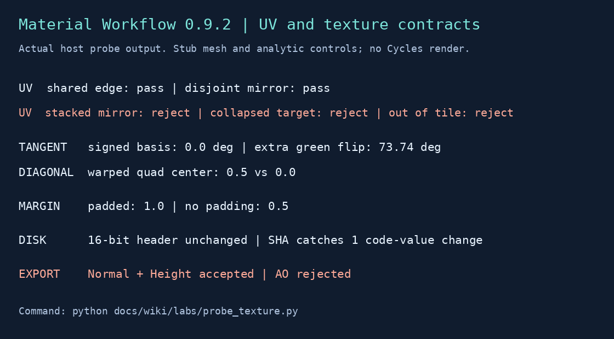

# UV、切线和贴图重建：主机证据

在仓库根目录运行 `python docs/wiki/labs/probe_texture.py`。0.9.2 的 UV 与导出检查走真实 Python 函数，网格对象用最小替身；缩图和镜像用精确算例；PNG 头和内容摘要读磁盘。本页未运行 Cycles，也未验游戏引擎。

| 检查 | 正例 | 反例 |
| --- | --- | --- |
| 目标槽 UV | 共享边、分离镜像岛、非目标槽叠岛均通过当前合同 | 同槽叠岛、退化与越界均拒绝 |
| 镜像切线 | 同一带符号基底角差 0° | 无条件反绿角差 73.74°；翘曲面的两种对角线中心高程 0.5／0 |
| 岛边缩图 | 算例中填充后为 1 | 无填充时背景混入，读 0.5 |
| 文件依赖 | 复制后 SHA-256 一致 | 改动一个 16-bit 码值，文件头不变、SHA-256 改变 |
| AO 路由 | 程序合同接收 Normal 与 Height | 程序合同拒绝 AO |

复验要求：生产小样用同一工作副本、目标 UV、烘焙与重建切线，保存原图与目标缩图，最后从干净工程读回变更后的路径。记录工具版本、参数及正反截图；不得将本页算例晋升为实际画质验收。

## 原生 AO 投射验收

状态：源代码已核对，以下是待运行的 Blender 5.3 / Cycles 对照。

1. 准备三个固定 UV 区域：开阔面、同一源高模上的凹槽、可单独移除源几何的对照面。固定 UV、分辨率、采样数、边距和 AO 距离；记录 Cage 模式。无 Cage 试样设 Extrusion 为 0 且不指定 Cage，以隔离 Max Ray Distance。
2. 第一轮保留全部源几何。在三个岛的内部取固定像素，验证都位于接收覆盖且命中源几何；开阔面 AO 高于凹槽。
3. 第二轮只移除对照区的源几何。前两区仍命中且灰度关系不变，对照区变为漏射，漏射总数上升；对照区导出的 AO 仍可为白色。
4. 保存两个见证缓冲（接收覆盖、源命中）的定点采样及 AO 截图，附两轮 `projection.json`。0.9.2 只保存汇总命中率；原版收据用于记录总数，不能充当局部见证。通过后把实际命令、参数和测量值加回本页。
