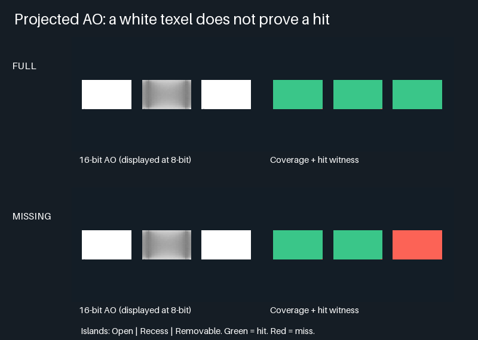

# UV、切线和贴图重建：主机证据

在仓库根目录运行 `python docs/wiki/labs/probe_texture.py`。0.9.2 的 UV 与导出检查走真实 Python 函数，网格对象用最小替身；缩图和镜像用精确算例；PNG 头和内容摘要读磁盘。本页未运行 Cycles，也未验游戏引擎。

| 检查 | 正例 | 反例 |
| --- | --- | --- |
| 目标槽 UV | 共享边、分离镜像岛、非目标槽叠岛均通过当前合同 | 同槽叠岛、退化与越界均拒绝 |
| 镜像切线 | 同一带符号基底角差 0° | 无条件反绿角差 73.74°；翘曲面的两种对角线中心高程 0.5／0 |
| 岛边缩图 | 算例中填充后为 1 | 无填充时背景混入，读 0.5 |
| 文件依赖 | 复制后 SHA-256 一致 | 改动一个 16-bit 码值，文件头不变、SHA-256 改变 |
| AO 路由 | 程序合同接收 Normal 与 Height | 程序合同拒绝 AO |

复验要求：生产小样用同一工作副本、目标 UV、烘焙与重建切线，保存原图与目标缩图，最后从干净工程读回变更后的路径。记录工具版本、参数及正反截图；不得将本页算例晋升为实际画质验收。

## 原生 AO 投射验收

状态：三岛合成试样已在 Blender 5.3.0／Cycles CPU 原生投射复现。插件绑定与生产 CLI 路由未验。

1. 另存独立接收体。给它一个本地节点材质：Principled 直连唯一活动的 ALL 输出，Normal 留空。负例在另一副本接上 Bump；0.9.2 在烘焙前检查每个槽，已有 Normal 接线只接受同一受管投射组。现有程序材质已接 Bump，不作首个投射试样。
2. 准备三个固定 UV 区域：开阔面、同一源高模上的凹槽、可单独移除源几何的对照面。固定 UV、分辨率、采样数、边距和 AO 距离；记录 Cage 模式。无 Cage 试样设 Extrusion 为 0 且不指定 Cage，以隔离 Max Ray Distance。
3. 第一轮保留全部源几何。在三个岛的内部取固定像素，验证都位于接收覆盖且命中源几何；开阔面 AO 高于凹槽。
4. 第二轮只移除对照区的源几何。前两区仍命中且灰度关系不变，对照区变为漏射，漏射总数上升；对照区导出的 AO 仍可为白色。
5. 保存两个见证缓冲（接收覆盖、源命中）的定点采样及 AO 截图，附两轮 `projection.json`。0.9.2 只保存汇总命中率；原版收据用于记录总数，不能充当局部见证。本试验的只读旁路保存了两数组；关掉旁路重新烘焙，两种试样的 Normal、Curvature、AO 六个 PNG 的文件 SHA-256 全部不变。

源码前置检查的主机对照：未接 Normal、原投射组接入通过；普通 Bump、第二槽接 Bump、仅指定单引擎的活动输出均拒绝。主机替身不产生实际贴图。插件原生算子已在源码注册；Linux 工作流仍需单独验证受管 CLI 投射入口，程序材质的 run／export 不是同一动作。

### 三岛实测：漏射填白与无遮挡同值

Blender 5.3.0（02f0899d78e3）／Cycles CPU，投射源码固定在 9d560ee（该文件与候选 0f39fcf 字节相同）。128²、32 samples、margin 0、无 Cage、Extrusion 0、Max Ray Distance 0.10、AO Distance 1.50。接收面 +Z，源平面在 Z = −0.015。同样参数把源放到 +0.015 的负例，3,267 接收纹素全部漏射。此方向和距离只用于此试样。

| 区域，各 96 纹素 | 全部源：命中／AO 中位数 | 移除第三源：命中／AO 中位数 |
|---|---:|---:|
| 开阔面 | 96／65,535 | 96／65,535 |
| 同一高模物件的凹槽 | 96／43,263 | 96／43,263 |
| 可移除源 | 96／65,535 | 0／65,535 |

两组接收覆盖相同（3,267）。全图漏射 2 → 1,091；“全部源”指源列表完整，**不等于全图零漏射**。前两区的 16 位线性 AO 逐像素相同。第三块缺源后仍全白；验收以局部命中判定，不以白色或全图百分比判定。AO 独立导出，本试验未烘或对比 Base Color。

复跑：用证据包的 replay/replay.sh（R16/R17 验证输入，以及 BLENDER_BIN 和 CPUSET）。脚本走隔离 blenderctl 0.64.0（4046c7a）的受管 material procedural-run 作业，在已重开的工作副本内调用插件原有 bake_projection；研究适配器替换的是原导出支路。material --help 未注册投射入口，不把复跑当作生产 CLI 支持。固定 ROI 为 PNG 左上原点半开坐标：开阔 [20,58,28,70]，凹槽 [60,58,68,70]，可移除 [100,58,108,70]。证据包括原生收据、原始双见证、FFmpeg 16 位解码与正反图。

跨物件遮挡另验。Painter 的 [Common Match 与次级射线](https://experienceleague.adobe.com/en/docs/substance-3d/bakers/common-questions/why-is-matching-by-name-not-working-with-ambient-occlusion-thickness) 和 [Self Occlusion 选项](https://experienceleague.adobe.com/en/docs/substance-3d-painter/using/baking/mesh-map-settings) 是两项控制；插件固定 Only Local，[该 Cycles CPU SVM 路径](https://github.com/blender/blender/blob/02f0899d78e3/intern/cycles/kernel/svm/ao.h#L71-L89)按命中的对象身份限制 AO 射线。下一对照保持主射线接收与源身份不变，只把凹槽挡板从同一高模拆为单独源。这里记录源码差异，不判 Painter 画质。
