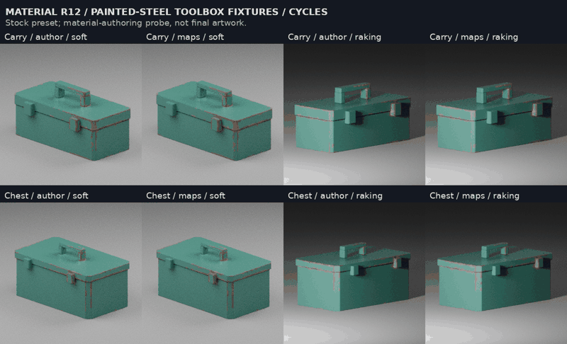

# 双工具箱：Blender 原生遮罩及贴图重建复验

范围：Blender 5.3.0，构建 02f0899d78e3；材质 [PR #3](https://github.com/tsist/blender-material-workflow/pull/3) 的 `0f39fcf`；带独立 Linux 适配的 blenderctl 0.64.0 实验构建。使用合成样件，未合并适配。

## 遮罩回归

1. 两件工具箱分别使用独占的 0–1 `UVMap` 和一个目标槽。把加图 A 和减图 E 作为两张 Non-Color PNG；记录 SHA-256，放入 `--resources`。留白作为对照。两图的加减区互不重叠。
2. 用三条 Math 信号组装 `max(P,A) × (1-E)`。普通喷漆粗糙度设为 0.55，磨亮层设为 0.20，只选 Roughness。把程序权重 P 设为 0.25，用 `material procedural-run` 另存工作副本。
3. 新进程用 `material procedural-export` 重开作者文件并比较导出。再以同一作者文件为输入，用 `material procedural-run` 把 P 改到 0.75，保留已暂存的 A 与 E；确认重用原受管材质。
4. 烘焙 128²、16-bit，边距设 0 以便定位。按输入 PNG 划出加、减、无笔迹三处，排除遮罩边缘的 3 像素和 UV 外未覆盖像素。对采样区用绝对误差 0.001 作判定。

| 样件 | 加区，保持 0.2000 | 减区，保持 0.5500 | 无笔迹，0.4625 → 0.2875 |
| --- | ---: | ---: | ---: |
| 便携箱 | 1984 | 969 | 4088 |
| 深箱 | 1652 | 1393 | 3753 |

两箱均通过作者文件存盘重开与纯贴图重建。单独冷开导出的 Roughness 与原烘焙逐字节一致；改参输出与从白模直接运行新参数逐字节一致。Base Color 和 Metallic 在各自四次作业中逐字节相同。本次加、减图是预制图，尚未验证 Blender 画笔入口。

## 喷漆预设与 UV 分流

在两件白模上另跑内置 `painted_metal`（边缘磨损，weathering 0.4）。两件源与求值几何的整件 UV 检查分别覆盖 1300、1384 个三角面，均无正面积重叠与退化。Cycles 生成 Edge 和 Cavity 两张 Non-Color 数据图，按职责用于遮罩；另输出 Base Color、Roughness、Metallic、Normal、Height 并重建。下图为两种灯光的节点版／纯图版；当前是工具测试，不是资产验收。此处 Cavity 由目标局部 AO 推导，不是独立的高低模投射 AO。

