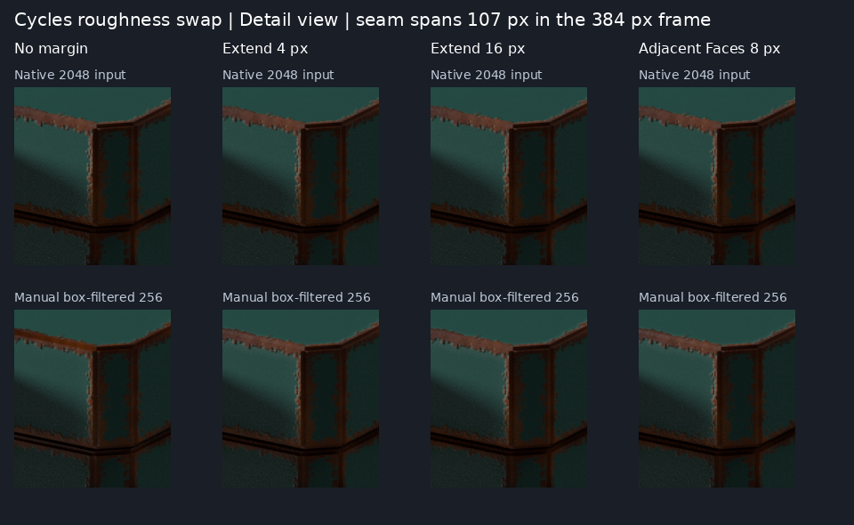
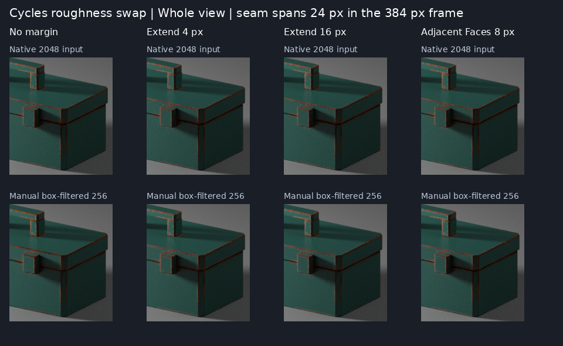

# UV 扩边在画面里有没有改善

切线法线的坐标基和原生扩边另验：[MW-015](../techniques/015-check-tangent-uv-basis.md)。本文数据只属粗糙度。
先看[原生七档扩边和盒滤数值](uv-padding-native.md)。本轮只问：把不同扩边的粗糙度接到同一份纯贴图材质，近景和整物画面是否会有可见差别？

## 控制与复跑

- 沿用 Blender 5.3.0（`02f0899d78e3`）、固定 CLI 和插件草稿。原 2K 烘焙流保持不动。取零扩边、Extend 4/16、Adjacent Faces 8 的原生 EXR 蓝通道；以无 Alpha 的 16 位灰阶 PNG 作线性粗糙度。逐图解码核对，误差不超过半个 16 位码。另作 8×8 盒滤的 256² 输入对照。
- 每份纯贴图工程从同一作者文件重建后冷开；除粗糙度外，其他通道按 SHA 完全一致。相机朝向、掠射灯光、AgX、384²、Cycles CPU 48 样本、种子 0 固定。近景与整物改变的是机位范围，而非输入贴图规格。
- 场景纹理缓存、自动生成和 Simplify 均关闭。按[该构建的 Cycles 加载逻辑](https://github.com/blender/blender/blob/02f0899d78e3/intern/cycles/scene/image.cpp#L482)，此处不是瓦片/mip 缓存路径。预滤 256 是显式换图，不能称作 Cycles 的 mip 选择。
- 相机投影几何边 93–136 后取中央 70% 的 ±3 像素带，另看 5–10 像素侧带；差值用显示端 RGB 代码和两侧成对亮度差，不冒充线性光能或粗糙度。

先完成 [R17 复跑](evidence/uv-padding/replay.sh)，保持其结果目录不动。复制已有隔离 CLI 得到 `cli-visual`，仅在该副本应用[视觉实验补丁](evidence/uv-padding-visual/visual.patch)。在 R17 重跑根放入[此轮脚本](evidence/uv-padding-visual/launch.sh)。

```sh
mkdir -p visual-prep
cp /path/to/wiki/docs/wiki/labs/evidence/uv-padding-visual/* visual-prep/
cp -a cli cli-visual
git -C cli-visual apply --check ../visual-prep/visual.patch
git -C cli-visual apply ../visual-prep/visual.patch
CPUSET="$ALLOWED_CPUSET" BLENDER_BIN="$VERIFIED_BLENDER" bash visual-prep/launch.sh
python visual-prep/analyze_render.py /path/to/visual-job /path/to/new-evidence
```

## 结果

R17 七张原生 EXR 的 SHA 及 35 组盒滤结果逐项重现。此轮独立 CLI 作业完成 8 组重建与两种尺度共 16 张实渲；同一几何缝在 384² 画面中分别长 106.6 / 23.7 像素，两视角的 19 个射线探针均命中切口。缝旁分别统计 444 / 102 像素。

**原生 2K：** Extend 4 与 16 在两个接缝窗口内逐像素相同；Adjacent 8 和零扩边相对 Extend 4 也至多差一个 8 位显示码。这次只换粗糙度，不能把没有明显改善推广到法线或颜色。

**显式 256²：** 下表以同机位的原生 2K Extend 4 为参照。每格为缝旁像素的最大单通道差值均值；右列是差至少 4 码的像素数（近景 / 整物）。

| 256² 粗糙度输入 | 近景平均码差 | 整物平均码差 | ≥4 码像素 |
| --- | ---: | ---: | ---: |
| 零扩边 | 6.658 | 3.578 | 269 / 36 |
| Extend 4 | 2.622 | 1.882 | 118 / 10 |
| Extend 16 | 1.266 | 1.735 | 31 / 10 |
| Adjacent Faces 8 | 1.687 | 1.725 | 41 / 10 |

近景的低分辨率零扩边有明显变亮的边缘；放宽 Extend 4 至 16 后，靠近切口的差异变弱。整物画面几种非零扩边的差距小，不足以仅凭这组决定更换默认。用成对跨缝亮度差则还有另一项取舍：近景 Adjacent 8 比 Extend 16 更接近 2K 的跨缝关系（0.939 vs 1.122 显示码），但前者的逐像素偏差更高。**为真的低分辨率输出或真实目标采样验收，别用盒滤偏差单独决定默认值。**





[渲染读回、输入哈希与逐项数值](evidence/uv-padding-visual/r18-receipt.json)。范围：单件工具箱、单条切口、单一光照、Cycles CPU 无纹理缓存。其他 UV 切口、切线法线、缓存及目标引擎的选级是不同验收。
