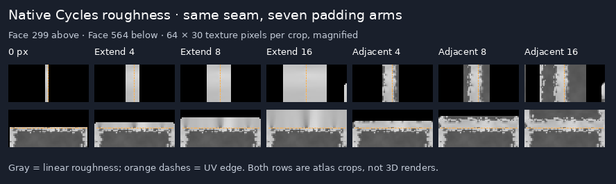

# 原生 UV 扩边对照：同一条缝，七档实烘

## 输入和取样

同一 [R16 便携工具箱](corner-seam-native.md) 与原 2K 8 位辅助图路线。Blender 5.3.0 `02f0899d78e3`、Cycles CPU、最终探针 2048²、16 样本、32 位浮点 EXR。按[官方烘焙定义](https://docs.blender.org/manual/en/5.3/render/cycles/baking.html#margin)，只改原生 Bake 的 `margin_type` 和 `margin`，对照 Extend 0/4/8/16 与 Adjacent Faces 4/8/16。生产导出仍走原分支，另做同材质的连线探针；这是标量粗糙度实验，不代表切线法线或 AO。

固定顶点 93–136，面 299/564，各取 65 个 0.3 mm 面内样点。按几何共享边且两个 UV 端点相同划分岛；有跨岛冲突的纹素排除。同岛参照分别滤粗糙度乘覆盖权重与权重，双线性取样后相除，空白不当作粗糙度零。2K 参照的权重最低 0.467，130 点中 65 点权重达到 .95；只看这 65 点时，256 档 Extend 4／16 仍明显有差（0.1014／0.0147）。按 R16 的原始不分岛基准计算，512 档 Extend 4 与零扩边为 0.0430／0.3874，复现旧值。本计算识别 206 个岛；两侧岛号 599、1141。从原始覆盖 alpha > .99 的 1,661,887 纹素核对，六个模式在覆盖内的粗糙度没有超过 3/65535 的变化。

## 复现

在独立目录解出 R16 复跑件。固定 CLI `4046c7a8677514e45b2490a12133b9e587ec279f` 和材质草稿 `0f39fcf0c62ee71f8264e807b52d18722ed20388`，材质根 Python 文件复制到 CLI 的 `tools/material_workflow_addon/`。先应用 R16 恢复包的 `replay/compat.patch`（`--ignore-space-change`），再应用 [R16 探针](evidence/corner-seam/probe.patch) 和 [R17 多档探针补丁](evidence/uv-padding/r17-native-padding.patch)。脚本、清单和真实回执位于 [复跑目录](evidence/uv-padding/replay.sh)，其中 `probe_corner.py` 沿用 R16。只使用工作副本。

```sh
cp /path/to/wiki/docs/wiki/labs/evidence/uv-padding/* evidence/
CPUSET="$ALLOWED_CPUSET" BLENDER_BIN="$VERIFIED_BLENDER" bash evidence/replay.sh
```

## 结果：2K 贴图盒滤代理

各值是同一条缝 130 点相对同岛 2K 基准的粗糙度平均绝对偏差；列不是屏幕分辨率。零扩边是真正的 Blender 零扩边烘焙，不是事后把已扩边的像素清零。

| 原生扩边 | 1024 | 512 | 256 | 128 |
| --- | ---: | ---: | ---: | ---: |
| 零扩边 | 0.1603 | 0.3669 | 0.4697 | 0.5431 |
| Extend 4 px | 0.0463 | 0.0581 | 0.1630 | 0.3425 |
| Extend 8 px | 0.0463 | 0.0581 | 0.0814 | 0.1974 |
| Extend 16 px | 0.0463 | 0.0581 | 0.0706 | 0.0850 |
| Adjacent Faces 4 px | 0.0545 | 0.0811 | 0.1640 | 0.3243 |
| Adjacent Faces 8 px | 0.0545 | 0.0811 | 0.1253 | 0.2535 |
| Adjacent Faces 16 px | 0.0545 | 0.0811 | 0.1216 | 0.2094 |

512 档三个 Extend 宽度的取样指标相同（0.0581）；256 档 Extend 4 → 8 → 16 px 为 0.1630 → 0.0814 → 0.0706。若以两侧差值偏离 2K 作为指标，256 档 Adjacent Faces 8 px 为 0.0985，低于 Extend 16 px 的 0.1225，但各面相对原值的总偏差更高（0.1253 对 0.0706）。选模式时分别看两面原值和跨缝变化。512／256 档的同岛低通过滤本身平均改变 0.0818／0.1240。回执分开保存图集减同岛、本岛低通及总偏差：逐点有符号值可相加，绝对值均值不可直接相加。Adjacent Faces 可能正确借到几何相邻面，不用「图集减同岛」单独判坏渗色。



[逐档数值、样本、覆盖与文件 SHA](evidence/uv-padding/receipt.json)。这些是**原生烘焙贴图经 CPU 盒滤的结果**。R17 的同机位的原生作者与基线纯图掠射近景用于核对基本机位，不是各档扩边的视觉对比。下一次需要在实际占屏尺度和相同光照下换图对照，另查资产切线法线和目标引擎自身采样。
