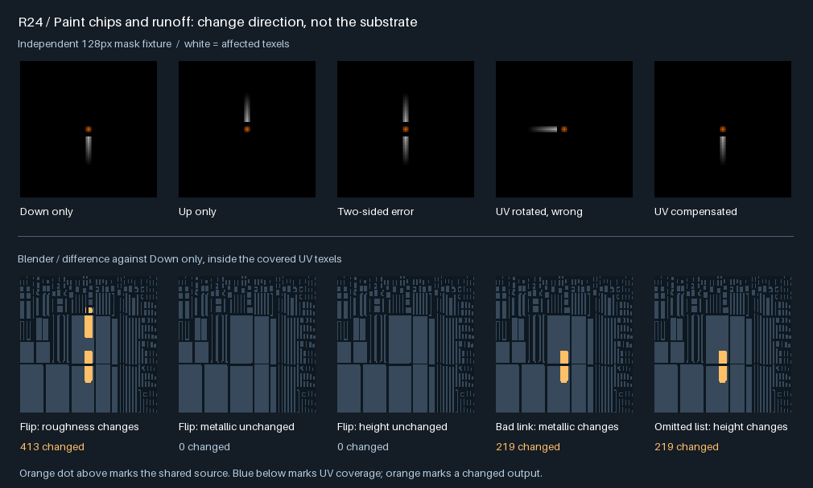
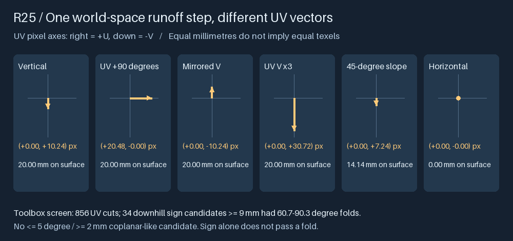

# 掉漆、露钢、锈蚀和水迹：两工具箱消融验证

范围：Blender 5.3.0（02f0899d78e3）＋材质 PR #3 `0f39fcf`＋隔离 Linux 程序材质 CLI。两件合成工具箱，Cycles CPU，整件独占 UV。

## 配方与复跑

1. 把 Edge 乘局部破碎纹理，得到冲击权重。用较低、较高两段区间分别生成 `coatLoss`、`steelExposure`。保留一层只见底漆的过渡。
2. 用 Cavity 和低处滞湿作为位置因子，乘独立水汽纹理生成 `moisture`。氧化遮罩 = `steelExposure × moisture × rustStrength`。
3. 制作独立水迹：狭长噪声乘侧面法向门槛和局部高度窗，再乘 `streakStrength`。两箱按自身高度设窗口。本试样使用资产局部 Z；真实世界重力需另给向量并验证。
4. 用诊断材质临时把掉漆、露钢、氧化、水迹分别接到 `metallic`、`coat_roughness`、`roughness`、`coat_weight`，不混入最终材质评价。从白模分别跑全开、`rustStrength=0`、`streakStrength=0` 三份，导出 128²、16-bit、无扩边。

```sh
blenderctl --jobs-dir "$jobs" material procedural-run "$whitebox" \
  --expected-sha256 "$source_sha" --resources "$resources_json" \
  --manifest "$variant_json" --export "$export_json"
```

在四张 Non-Color PNG 的覆盖交集测量。容差为三个 16-bit 码值；非目标遮罩以文件 SHA 判定。

| 样件 | 有覆盖 | 掉漆 > 0.1 | 露钢 > 0.1 | 氧化 > 0.1 | 水迹 > 0.1 | 露钢 > 0.5 且氧化 < 0.02 |
| --- | ---: | ---: | ---: | ---: | ---: | ---: |
| 便携箱 | 8849 | 662 | 233 | 74 | 247 | 36 |
| 深箱 | 8536 | 674 | 277 | 94 | 264 | 62 |

- 两箱全部有覆盖纹素均满足 `氧化 ≤ 露钢 ≤ 掉漆`。仅露底漆的独立过渡区分别 213、207 个纹素。
- 关氧化只归零氧化图；关水迹只归零水迹图。每个反例另外三图逐字节相同。
- 方向负例：相同白模在物体 X 轴旋转 90° 前后，局部 Z 烘焙的 8849 个覆盖纹素中 8839 完全相同，最大差 3/65535，覆盖相同。SHA 不同，却没有随世界竖直方向换位置。位置纹理跟随资产；不能当成当前世界重力。
- 最终通道试样：两件分别用 512² 图导出和重建，柔光、掠射光各对照作者版／纯贴图版。样片能区分底漆、稀疏锈和细水迹；边角和握位细节仍不足，该批未做 2K 或 AAA 画质验收。2K 分辨率因子另见[辅助图 A/B](mesh-map-resolution-native.md)。


商业行为对照：[Adobe Painter 水迹](https://experienceleague.adobe.com/en/docs/substance-3d-painter/using/effects/generators/dripping-rust)、[Designer 的 Leaks 输入](https://experienceleague.adobe.com/en/docs/substance-3d-designer/using/substance-graphs/nodes-reference-for-substance-graphs/node-library/mesh-based-generators/mask-generators/leaks)。复验是自写配方，不是对商业生成器的像素复刻。

## Material Maker 源图：先查斑点和流痕有没有独立出口

证据：两份公开 `.ptex` 的静态接线，不是 Material Maker 烘图。下表中的通道编号由 [1.2p1 Material](https://github.com/RodZill4/material-maker/blob/8157a288b607c7752880395e06c5bf4f3466bd51/addons/material_maker/nodes/material.mmg) 和 [1.4 Tessellated](https://github.com/RodZill4/material-maker/blob/a6f76d5a5ece8a29146620f07975ee40543f4e29/addons/material_maker/nodes/material_tesselated.mmg) 的输入定义确认。两个条目均标 CC0；派生图内嵌自定义分组和着色器，未逐项核验再分发许可，未移植。

| 源图 | 可核查接线 | 判断 |
| --- | --- | --- |
| [Arnklit，659](https://materialmaker.org/material?id=659)，40 个顶层节点、52 条边 | Voronoi 与 FBM 合成后过 `tones_step_2`。该阈值可达颜色、粗糙度、法线、AO；反转后经 `directional_blur → warp_2 → blend2_5` 到颜色。Metallic 端口无接线，参数为 0。 | 借鉴涂层边缘与流痕的分支；不能把这张图的颜色当作露钢或氧化遮罩。 |
| [rubberduck，1243](https://materialmaker.org/material?id=1243)，285 个顶层节点、341 条边 | 两个 `Chipping Mask Gen` 合流到 `blend2_52`；该节点能到六个已接线的 PBR 输入。两个 `Rust Leaks` 各有不透明度、长度、角度图输入；第二个接了不透明度输入。两组均只把输出 0（流痕）接到顶层下游；输出 1（起点斑）虽已提供，当前未接出。 | 可借鉴起点与流痕的独立端口。流痕本身的接线可达颜色、粗糙度、法线、深度；可达代表需要复验，不代表各通道像素一定变化。 |

两图都没有独立遮罩 Export 节点。验证时把中间信号接到 [Export 节点](https://rodzill4.github.io/material-maker/doc/node_miscellaneous_export.html)，不要从最终颜色倒推。自研验收加两步：

1. 同一源点先分别输出涂层破口、原地氧化、流痕起点与流痕尾迹。只改流痕长度或方向，比较尾迹而不是只看 Base Color；破口、原地氧化与起点应不变。正例用单侧窄条；反例把模糊改成双侧，必须能检出逆向尾巴。
2. 原地锈仍满足 `氧化 ≤ 露钢`。流痕尾迹属于沉积层，可以经过下方完好的漆面，不能借尾迹打开露钢、涂层深度或金属度。图中的角度贴在二维纹理上；真实重力另用旋转资产或旋转 UV 的控制组验收。

### 复核源图与端口

```sh
for id in 659 1243; do
  curl -fsSL "https://materialmaker.org/api/getMaterial?id=$id" -o "$id.json"
done
python - <<'PY'
from collections import deque
import hashlib, json
seeds = {659: ["tones_step_2", "directional_blur"],
         1243: ["blend2_52", "graph_9", "graph_14"]}
for i, names in seeds.items():
    with open(f"{i}.json", encoding="utf8") as f:
        payload = json.load(f)
    assert int(payload["id"]) == i
    raw = payload["json"].encode()
    g = json.loads(raw)
    edges = g["connections"]
    print(i, hashlib.sha256(raw).hexdigest(), len(g["nodes"]), len(edges))
    for name in names:
        todo, seen, ports = deque([name]), {name}, set()
        while todo:
            src = todo.popleft()
            for e in edges:
                if e["from"] != src:
                    continue
                dst = e["to"]
                if dst == "Material":
                    ports.add(e["to_port"])
                elif dst not in seen:
                    seen.add(dst)
                    todo.append(dst)
        print(name, sorted(ports))
    for e in edges:
        if e["from"] in {"graph_9", "graph_14"}:
            print(e["from"], e["from_port"], e["to"])
PY
```

读取 `json` 字符串（不是外部响应整包）的 UTF-8 SHA-256：659 `808aced3007670f594dd2b40d4884080da1cb29f3530ecfdf44d01082519412b`；1243 `1108af82d90bd992c0a27a1f6d84aeb6fa8ac1a3abb79a42a89e5e2d7292aba0`。如哈希变化，重新追踪。按节点遍历是保守的依赖筛查，不解析着色器或求值；不据此认证运行时、GPU 成本或最终像素。

## R24｜单向沉积层必须显式限制写入通道

本轮把运输和合成分两层验证。先独立生成 128²、16 位遮罩：同一源点沿一个方向位移 1–32 px、递减权重、取最大值，并排除原破口；边界零填充，不回卷。顺向只有下侧 166 纹素，反向只有上侧 166；双向错误两侧各 166。将二维 UV 图旋转 90° 后继续沿图像行采样会变成横向；同时变换方向再还原，同原遮罩逐像素相同。这里的运输在图像域完成；没有模拟世界重力或跨 UV 岛的连续流动。

将遮罩作为独立 Non-Color 资源接入同一个便携箱研究副本。Blender 5.3.0 / Cycles CPU；隔离 CLI `4046c7a`、材质候选 `0f39fcf`。沉积层在样片中只改 Base Color 和 Roughness。**必须写 `affects`；省略字段时这一版本让层参与全部通道，漏写的值会取默认值，不能当作继承下层。** 例如：

```json
{
  "id": "deposit", "name": "Runoff deposit", "enabled": true, "opacity": 1,
  "mask": "downstream", "affects": ["base_color", "roughness"],
  "channels": {}, "values": {"base_color": [0.25, 0.12, 0.052, 1], "roughness": 0.55}
}
```

```sh
blenderctl --jobs-dir "$jobs" material procedural-run "$whitebox" \
  --expected-sha256 "$whitebox_sha" --resources "$resources" \
  --manifest "$manifest" --export "$export"
```

六组均完成作者工程冷开、原始文件/资源 SHA 守卫、贴图重建及重开。固定 128²、4 样本、零扩边，独立解码 16 位 PNG 和浮点 EXR；8,849 个已覆盖纹素内，相对显式顺向组的变化数：

| 对照 | Base Color | Roughness | Metallic | Height |
| --- | ---: | ---: | ---: | ---: |
| 反向 | 414 | 413 | 0 | 0 |
| 双向错误遮罩 | 195 | 194 | 0 | 0 |
| 同顺向遮罩，省略 `affects` | 0 | 0 | 0 | 219 |
| 同顺向遮罩，故意把金属与高度接进沉积层 | 0 | 0 | 219 | 219 |
| UV 补偿后等价遮罩 | 0 | 0 | 0 | 0 |

省略 `affects` 时，RGB 和 Roughness 完全一样，但 Height 最大绝对差为 0.090155（导出数值；不是米）。因此不能只凭颜色和粗糙度通过验收。正确反向和双向组的 Metallic、Height、Alpha 全图解码值同基准完全一致。双向例仍应因方向错误打回。这个样片是通道隔离试验，不是成品材质评审；有实体积垢时，应另明确独立的沉积微起伏，不能悄悄改基材厚度。



## R25｜世界下坡先投到表面，再换算 UV

适用：需要流痕随物体实际朝向变化的静态表面。验证范围为离线三角面计算与已归档便携箱网格筛选；未运行 Blender、烘图、求解跨棱液体或完成视觉验收。

1. 用求值后的**世界坐标**三角形边组成矩阵 (A)（3×2），用相同顶点顺序的 UV 边组成 (U)（2×2）；几何法线从 (A) 两列叉积求出，不用法线贴图。(J=A U^{-1}) 是 UV 到世界位移的雅可比。[pbrt 的三角面微分](https://www.pbr-book.org/4ed/Shapes/Triangle_Meshes) 给出同类求导；流痕拒绝退化 UV，不借用着色器任意切线作回退。
2. 对单位世界下向量 (g) 计算 (g_t=g-n(ncdot g))。试件采用 (d=0.020g_t) 米，保留坡度；这是可控的单步比例，不是液体速度。用最小二乘解 (J,Delta uv=d)，或先解 (Ab=d) 再计算 (Delta uv=Ub)。不要把 (Delta uv) 再归一化。对于行向下的宽 (W)、高 (H) 的贴图，像素位移为 ((WDelta u,-HDelta v))。
3. 用 (J,Delta uv) 读回世界方向和长度。试件 4 种表面状态 × 5 种 UV 布局：立板为 20 mm，45° 倾板 14.14 mm，水平板为零；旋转、翻转、剪切和拉伸 UV 后，世界位移不变。2048×1024 立板原、旋转、镜像、拉伸分别读到 ((0,10.24))、((20.48,0))、((0,-10.24))、((0,30.72)) px。固定“UV 向下”会让旋转组在世界横跑 40 mm；固定 UV 步长 0.01 会把拉伸组的 20 mm 压至 6.67 mm。

```python
import numpy as np
g = np.array([0., 0., -1.])
# P: 3x3 world vertices; Q: 3x2 UVs, same corner order.
A, U = (P[1:] - P[0]).T, (Q[1:] - Q[0]).T
if max(np.linalg.cond(A), np.linalg.cond(U)) > 1e5:
    raise ValueError("degenerate triangle or UV chart")
n = np.cross(A[:, 0], A[:, 1])
n /= np.linalg.norm(n)
d = .020 * (g - n * (g @ n))
delta = U @ np.linalg.lstsq(A, d, rcond=None)[0]
J = np.linalg.solve(U.T, A.T).T
assert np.linalg.norm(J @ delta - d) < 1e-10
```

跨岛前先用共享几何边配对，不在图集上直接拖线。检查两侧对边顶点重心坐标的变化：上游出片为负，下游进片为正；水平终点为零不能作连续下坡。共面合成缝通过，后片放平的负例被拒。便携箱 1,300 个有效三角面、856 条 UV 切口，242 条符号满足；其中 34 条长度至少 9 mm，但折角为 60.72°–90.26°。预设的近共面门槛（≥2 mm、≤5°）没有任何候选。这是边筛选，不是路径追踪或实际沉积结果。下一次要测过棱，应另设明确的折角、挡边与积流策略。


