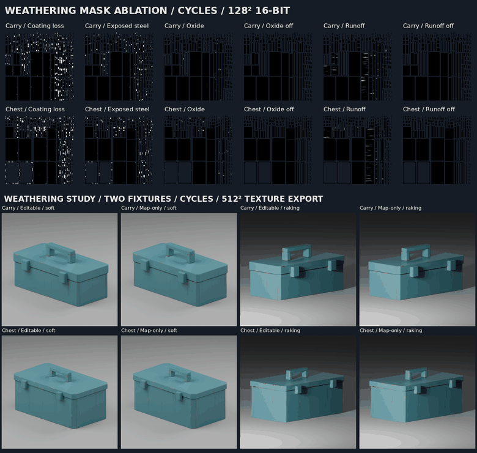

# 掉漆、露钢、锈蚀和水迹：两工具箱消融验证

范围：Blender 5.3.0（02f0899d78e3）＋材质 PR #3 `0f39fcf`＋隔离 Linux 程序材质 CLI。两件合成工具箱，Cycles CPU，整件独占 UV。

## 配方与复跑

1. 把 Edge 乘局部破碎纹理，得到冲击权重。用较低、较高两段区间分别生成 `coatLoss`、`steelExposure`。保留一层只见底漆的过渡。
2. 用 Cavity 和低处滞湿作为位置因子，乘独立水汽纹理生成 `moisture`。氧化遮罩 = `steelExposure × moisture × rustStrength`。
3. 制作独立水迹：狭长噪声乘侧面法向门槛和局部高度窗，再乘 `streakStrength`。两箱按自身高度设窗口。本试样使用资产局部 Z；真实世界重力需另给向量并验证。
4. 用诊断材质临时把掉漆、露钢、氧化、水迹分别接到 `metallic`、`coat_roughness`、`roughness`、`coat_weight`，不混入最终材质评价。从白模分别跑全开、`rustStrength=0`、`streakStrength=0` 三份，导出 128²、16-bit、无扩边。

```sh
blenderctl --jobs-dir "$jobs" material procedural-run "$whitebox" \
  --expected-sha256 "$source_sha" --resources "$resources_json" \
  --manifest "$variant_json" --export "$export_json"
```

在四张 Non-Color PNG 的覆盖交集测量。容差为三个 16-bit 码值；非目标遮罩以文件 SHA 判定。

| 样件 | 有覆盖 | 掉漆 > 0.1 | 露钢 > 0.1 | 氧化 > 0.1 | 水迹 > 0.1 | 露钢 > 0.5 且氧化 < 0.02 |
| --- | ---: | ---: | ---: | ---: | ---: | ---: |
| 便携箱 | 8849 | 662 | 233 | 74 | 247 | 36 |
| 深箱 | 8536 | 674 | 277 | 94 | 264 | 62 |

- 两箱全部有覆盖纹素均满足 `氧化 ≤ 露钢 ≤ 掉漆`。仅露底漆的独立过渡区分别 213、207 个纹素。
- 关氧化只归零氧化图；关水迹只归零水迹图。每个反例另外三图逐字节相同。
- 方向负例：相同白模在物体 X 轴旋转 90° 前后，局部 Z 烘焙的 8849 个覆盖纹素中 8839 完全相同，最大差 3/65535，覆盖相同。SHA 不同，却没有随世界竖直方向换位置。位置纹理跟随资产；不能当成当前世界重力。
- 最终通道试样：两件分别用 512² 图导出和重建，柔光、掠射光各对照作者版／纯贴图版。样片能区分底漆、稀疏锈和细水迹；边角和握位细节仍不足，未做 2K 或 AAA 画质验收。



商业行为对照：[Adobe Painter 水迹](https://experienceleague.adobe.com/en/docs/substance-3d-painter/using/effects/generators/dripping-rust)、[Designer 的 Leaks 输入](https://experienceleague.adobe.com/en/docs/substance-3d-designer/using/substance-graphs/nodes-reference-for-substance-graphs/node-library/mesh-based-generators/mask-generators/leaks)。复验是自写配方，不是对商业生成器的像素复刻。
